### Hi 👋, I'm [GentleCold](https://gentlecold.top)

- 🎓 Pursuing master's degree in ECNU.
- 🧐 Interested in LLM inference acceleration and KV cache systems.
- ⚡️ Working on GPU/SSD offloading and distributed cache sharing.
- 🐧 Using Arch Linux btw.

#### Selected Work 🎯

- [DaseR](https://github.com/GentleCold/DaseR): RAG-native KV cache service for LLM inference.
- [pegaflow](https://github.com/GentleCold/pegaflow): high-performance KV cache storage with GPU offloading, SSD caching, and RDMA-based sharing.
- [LMCache](https://github.com/GentleCold/LMCache): exploring KV cache reuse and offloading for LLM serving.
- [Mooncake](https://github.com/GentleCold/Mooncake): KV cache-centric disaggregated serving; contributing to Mooncake Store.
- [vLLM](https://github.com/vllm-project/vllm): the inference engine my KV cache connectors plug into.
- [SGLang](https://github.com/sgl-project/sglang): exploring KV cache offloading and sharing in SGLang serving.

  

